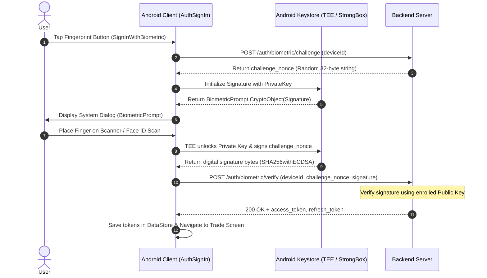
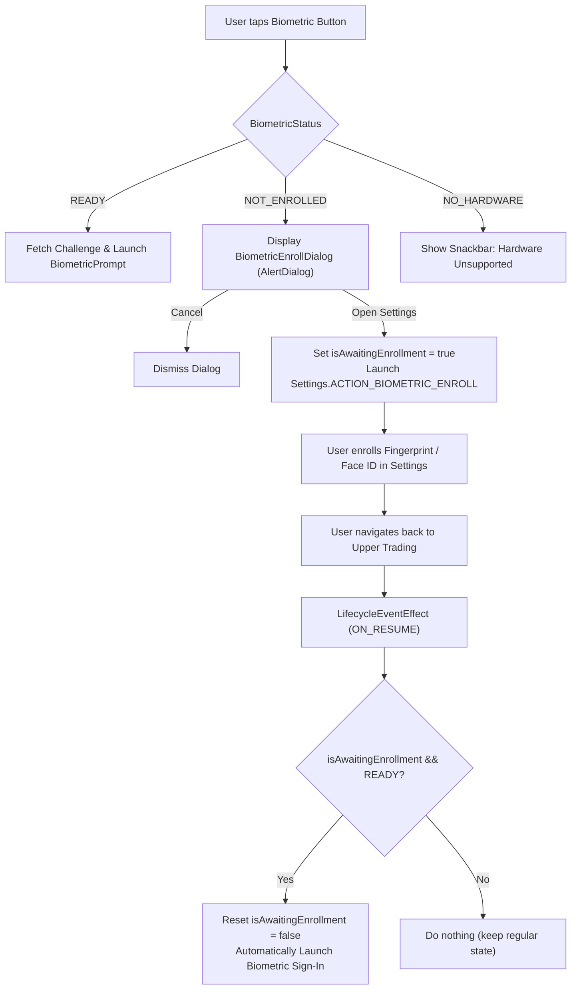

# Biometric Authentication Architecture & Implementation Guide

## 1. Overview & Threat Model
In financial and trading applications, static authentication (such as sending `{"isBiometricSuccess": true}`) is strictly prohibited because it is vulnerable to runtime instrumentation (e.g., Frida hooks) and replay attacks.

This implementation provides enterprise-grade biometric sign-in using:
- **Hardware-Backed Keystore (TEE / StrongBox Keymaster)**: Cryptographic keys never leave the secure hardware enclave.
- **Hardware-Enforced User Authentication**: The Trusted Execution Environment (TEE) refuses to sign any payload unless authorized by a Class 3 biometric event.
- **Challenge-Response Signature Scheme**: Prevents replay attacks by signing a time-bounded server nonce with `SHA256withECDSA`.

---

## 2. Core Concepts & Q&A

### Q1: What is Android Keystore and why not use standard storage?
Android Keystore (`AndroidKeyStore` provider) is **not** a file storage mechanism (like DataStore, SharedPreferences, or SQLite). It is an abstraction layer over the device's secure hardware enclave:
- **TEE (Trusted Execution Environment)**: A secure operating environment isolated from the main Android OS.
- **StrongBox Keymaster**: A dedicated hardware chip (Secure Element) with physical tamper-resistance.
- **Non-exportable Private Key**: The Private Key is generated inside the hardware and **NEVER leaves the hardware enclave**. Even if an adversary gains root access or dumps application RAM, the private key material cannot be extracted.
- **Hardware-Enforced Gatekeeper**: When configured with `setUserAuthenticationRequired(true)`, the hardware enclave locks the Private Key. It will only perform crypto operations when the Android OS confirms a valid biometric match associated with `BiometricPrompt.CryptoObject`.

### Q2: Why check `!keyStore.containsAlias(KEY_ALIAS)` before key generation?
An asymmetric key pair (`secp256r1`) serves as the device's permanent digital identity:
1. **Public Key**: Exported and registered with the backend server during device enrollment.
2. **Private Key**: Kept permanently inside the device's TEE.
3. If the app regenerated keys on every login:
   - The previously enrolled Public Key stored on the backend would no longer match the new Private Key, causing all signature verifications to fail.
   - Key generation on hardware TEE is computationally expensive.
   - Therefore, the app only generates the key pair once (`!containsAlias(KEY_ALIAS)`). Subsequent sign-ins reuse the existing private key.

### Q3: What is a "Rogue Fingerprint Attack" and how does `setInvalidatedByBiometricEnrollment(true)` protect against it?
- **The Threat**: An attacker steals an unlocked phone or knows the user's lock-screen PIN (`1234`). The attacker goes to Android System Settings and registers **their own fingerprint**.
- **The Defense**: When configuring `KeyGenParameterSpec`, the flag `.setInvalidatedByBiometricEnrollment(true)` instructs the hardware TEE to monitor the system biometric enrollment database.
- **The Consequence**: The moment any new fingerprint or face model is enrolled or modified in device Settings, the TEE **permanently and irreversibly invalidates the existing Private Key**.
- **Runtime Handling**: The next time the app attempts to initialize a `Signature` with this key, Android throws `KeyPermanentlyInvalidatedException`. Production financial apps catch this exception, force the user to re-authenticate with primary credentials (password + 2FA), wipe the invalid key, and regenerate a new key pair.

### Q4: Why Asymmetric ECDSA (`secp256r1`) instead of Symmetric AES for cloud authentication?
- **Symmetric (AES-GCM)**: The same key encrypts and decrypts. If used for backend authentication, the server must either know the secret key or store a decryptable version. If the server database is breached, attacker compromises every user's authentication secret.
- **Asymmetric (ECDSA `SHA256withECDSA`)**:
  - **Private Key**: Never leaves the device hardware enclave.
  - **Public Key**: Shared with and stored on the backend server.
  - The server **only verifies** the digital signature against the challenge nonce. Even a catastrophic server database breach leaks zero private keys, making asymmetric cryptography the mandatory industry standard for financial apps.

### Q5: Why does `CryptoObject` strictly require Class 3 (Strong) Biometrics?
Android categorizes biometric sensors into three security tiers based on Spoof Acceptance Rate (SAR):
1. **Class 3 (Strong)**: Optical/ultrasonic in-display fingerprint sensors, capacitive hardware sensors, 3D IR structured-light Face Unlock. Spoof Acceptance Rate $< 7\%$.
2. **Class 2 (Weak)**: Standard 2D RGB front-camera face unlock. Spoof Acceptance Rate $< 20\%$.
3. **Class 1 (Convenience)**: Voice recognition, smart lock.

**Key Rule**: Android Keystore hardware keys with `setUserAuthenticationRequired(true)` can **ONLY** be unlocked by Class 3 (Strong) sensors. Attempting to associate a `CryptoObject` with `BIOMETRIC_WEAK` or `DEVICE_CREDENTIAL` will cause `BiometricPrompt.authenticate()` to throw `IllegalArgumentException`.

### Q6: What happens during Device Migration or Cloud Backup Restore?
- Hardware-backed Keystore keys are physically bound to the TEE silicon chip of that exact physical device.
- Even if the app's DataStore / SharedPreferences are backed up and restored onto a new phone via Google Drive Auto Backup (`android:allowBackup="true"`), the Keystore Private Key **will NOT transfer to the new phone**.
- **Handling**: The app must treat a missing key as a normal state: check `!keyStore.containsAlias(KEY_ALIAS)`, prompt the user to sign in once with password/OTP, and re-enroll the biometric key for the new device hardware.

### Q7: How does Biometric Lockout work (`BIOMETRIC_ERROR_LOCKOUT` vs `PERMANENT`)?
- **Temporary Lockout (`BIOMETRIC_ERROR_LOCKOUT`)**: Occurs after 5 consecutive failed scan attempts. Android suspends sensor access for 30 seconds.
- **Permanent Lockout (`BIOMETRIC_ERROR_LOCKOUT_PERMANENT`)**: Occurs after repeated failures beyond the temporary lockout. The sensor is completely locked until the user unlocks the device with their primary screen lock (PIN, Pattern, or Password).
- **UX Best Practice**: When these error codes are received in `onError`, display a clear fallback action ("Too many failed attempts. Please sign in using your password").

---

## 3. End-to-End Sequence Diagram



---

## 4. Enrollment & Auto-Resume Workflow

When a user taps the biometric button on a device where biometrics have not yet been set up:



---

## 5. Architectural Component Mapping

| Layer | Component | File Path | Responsibility |
|---|---|---|---|
| **Core** | `BiometricAuthManager` | [BiometricAuthManager.kt](file:///data/project/upper-trading/app/src/main/java/com/upper/trading/core/biometric/BiometricAuthManager.kt) | Hardware key generation, TEE status inspection, digital signing (`signChallenge`). |
| **Core** | `BiometricPromptHelper` | [BiometricPromptHelper.kt](file:///data/project/upper-trading/app/src/main/java/com/upper/trading/core/biometric/BiometricPromptHelper.kt) | AndroidX `BiometricPrompt` builder bound to `FragmentActivity`. |
| **Data** | `AuthRemoteDataSource` | [AuthRemoteDataSourceImpl.kt](file:///data/project/upper-trading/app/src/main/java/com/upper/trading/data/remote/datasource/AuthRemoteDataSourceImpl.kt) | Remote API communication (`/challenge` & `/verify`). |
| **Data** | `UserSessionDataStorage` | [UserSessionDataStorageImpl.kt](file:///data/project/upper-trading/app/src/main/java/com/upper/trading/data/local/datastore/UserSessionDataStorageImpl.kt) | Persistent `isBiometricEnabled` flag and `Settings.Secure.ANDROID_ID`. |
| **Domain**| `AuthRepository` | [AuthRepositoryImpl.kt](file:///data/project/upper-trading/app/src/main/java/com/upper/trading/data/repository/AuthRepositoryImpl.kt) | Injects real `deviceId`, saves biometric flag upon successful login. |
| **UI** | `AuthSignInViewModel` | [AuthSignInViewModel.kt](file:///data/project/upper-trading/app/src/main/java/com/upper/trading/presentation/features/auth/signin/AuthSignInViewModel.kt) | Manages state, dialog visibility, and auto-resume on return from Settings. |
| **UI** | `AuthSignInScreen` | [AuthSignInScreen.kt](file:///data/project/upper-trading/app/src/main/java/com/upper/trading/presentation/features/auth/signin/AuthSignInScreen.kt) | Clean Compose view with `LifecycleEventEffect(ON_RESUME)` and extracted helper functions. |

---

## 6. Manual Testing & ADB Command Reference

### 6.1 Forgotten Lock Password / Resetting Emulator Lock
If you forgot the lock PIN/password on the emulator:
```bash
# Option A: Disable lock screen immediately (bypasses PIN prompt without knowing old PIN)
adb -s emulator-5554 shell locksettings set-disabled true

# Option B: Standard clean reset when old PIN (1234) is known:
# (Note: This automatically wipes ALL enrolled fingerprints and Face ID profiles simultaneously)
adb -s emulator-5554 shell locksettings clear --old 1234
```

### 6.2 Testing Fingerprint Authentication
```bash
# 1. Setup a standard PIN (1234)
adb -s emulator-5554 shell locksettings set-pin 1234

# 2. Launch Fingerprint Enrollment Wizard in Settings
adb -s emulator-5554 shell am start -a android.settings.BIOMETRIC_ENROLL --ei android.provider.extra.BIOMETRIC_AUTHENTICATORS_ALLOWED 15

# 3. Simulate placing finger #1 on the sensor (repeat 5 times until 100% completed)
adb -s emulator-5554 emu finger touch 1

# 4. In Upper Trading app: Tap Fingerprint icon -> BiometricPrompt appears
# Simulate matching scan (Finger #1 - Success):
adb -s emulator-5554 emu finger touch 1

# Simulate unrecognized finger (Finger #2 - Failure / "Not recognized"):
adb -s emulator-5554 emu finger touch 2
```

### 6.3 How Android Chooses Modality (PIN vs Fingerprint vs Face ID)
When a device has PIN, Fingerprint, and Face ID all configured:
1. **Unified BiometricPrompt**: `BiometricPrompt` with `BIOMETRIC_STRONG` is a unified system sheet managed by Android OS.
2. **Hardware Coexistence**: Face ID scans automatically via camera while the fingerprint icon/sensor is simultaneously active. The user can authenticate using **either Face ID or Fingerprint**.
3. **ADB Automation**: For automated and local manual testing on Android Emulators, fingerprint simulation (`emu finger touch 1`) is the official deterministic standard supported by Android SDK tooling.
